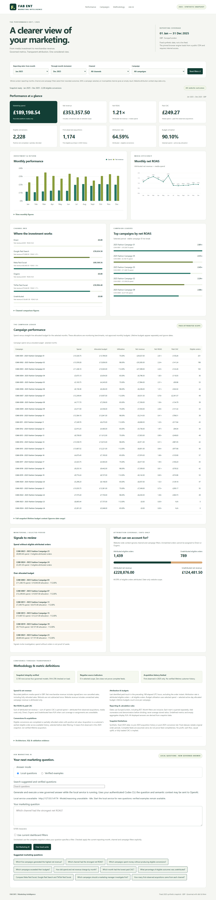
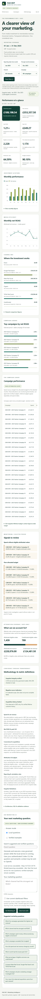

# Fab ENT Marketing Intelligence

Synthetic UK fashion marketing data for the fixed 2025 reporting period, in GBP.
Read [PROJECT_BRIEF.md](PROJECT_BRIEF.md), [METRIC_CONTRACT.md](METRIC_CONTRACT.md)
and [DATA_DICTIONARY.md](DATA_DICTIONARY.md) for scope, metric policies and fields.

## Architecture

Raw marketing CSVs -> governed dbt marts -> validated Wren semantic models ->
exported fixed Parquet snapshots -> DuckDB WebAssembly -> browser dashboard.

dbt transforms the seeded raw data into governed analytics tables in DuckDB.
Wren provides a tested semantic layer for read-only local queries and reproducible
exports. The static [marketing dashboard](docs/index.html) consumes those exports
with no backend. Serve it over HTTP using the Phase 6 instructions below.

Phase 1 loads and validates the raw CSV seeds in DuckDB. Phase 2 adds the clean
staging layer. Phase 3 adds tested order attribution. Phase 4 adds governed
marketing marts. Phase 5 connects these marts to a tested local Wren semantic
layer. Phase 6 adds the browser dashboard. Phase 7 adds local marketing questions
and an explicit saved-example mode; see [Phase 7](#phase-7-ask-marketing-ai).

## Phase 1: dbt + DuckDB seeds

The repository root is the dbt project. `seed-paths: [data/raw]` loads the seven
existing CSVs directly, without copying them. `data/raw/seeds.yml` declares every
column type: identifiers/text as VARCHAR, money as DECIMAL(18,2), counts as BIGINT,
dates as DATE and UTC timestamps as TIMESTAMPTZ. Blank session identities and
campaign IDs load as NULL. The connection timezone is UTC; raw values and all
order statuses are retained.

The local database is `data/generated/fab_ent.duckdb`, with tables in schema
`raw` (for example, `raw.orders`). This database, `.venv`, `.dbt`, local profiles,
dbt targets/logs/packages and DuckDB temporary files are excluded from Git.
`profiles.yml.example` contains only a relative path and no credentials.
Staging does not resolve outstanding business metric policies.

## Windows PowerShell setup

Run all commands from the repository root. Use Python 3.14 (validated with
3.14.4), with `python` available on PATH, plus Git. Dependencies are pinned in
`requirements.txt`: dbt-core 1.12.6, dbt-duckdb 1.11.0 and DuckDB 1.5.6.
Installation needs access to PyPI; no database server or dbt account is needed.

```powershell
python --version
python -m venv .venv
.\.venv\Scripts\python.exe -m pip install -r requirements.txt
.\.venv\Scripts\python.exe -m pip check
New-Item -ItemType Directory -Force .dbt, data/generated | Out-Null
if (-not (Test-Path .dbt/profiles.yml)) {
    Copy-Item profiles.yml.example .dbt/profiles.yml
}
```

Using the virtual environment executables directly avoids PowerShell activation
and execution-policy changes. Keep the database path in the local profile as
shown for the validation script below. Relative database paths resolve from the
working directory, so always run from the repository root. Explicit
`--profiles-dir .dbt` uses the repository's ignored local profile.

## Load and verify

```powershell
.\.venv\Scripts\python.exe scripts/validate_raw_data.py
.\.venv\Scripts\dbt.exe debug --profiles-dir .dbt
.\.venv\Scripts\dbt.exe seed --profiles-dir .dbt --full-refresh
.\.venv\Scripts\python.exe scripts/validate_seed_load.py
git diff --check
git status --short
```

Each command should exit successfully; stop if one fails. The raw validator
checks keys, references, date coverage, monetary arithmetic and isolated source
fixtures. Its attribution diagnostic covers all statuses and is not a dbt
attribution model or published metric. The seed validator opens DuckDB read-only,
checks all seven table counts, compares every typed row against the CSVs in both
directions (including duplicates and NULLs), checks fixed snapshot totals, and
reconciles every order to its lines. No dbt packages are required.

Repeat the seed and validation commands to rebuild the raw tables from the same
snapshot. `--full-refresh` recreates the seed tables, including their types.
Do not run `scripts/generate_synthetic_data.py` as part of this setup: it
overwrites the existing CSV snapshots. Close other DuckDB connections before
seeding to avoid file locks. `dbt clean --profiles-dir .dbt` removes only
`target/` and `dbt_packages/`; it retains the local database and raw CSVs.

## Phase 2: staging

After loading the seeds, build and validate staging from the repository root:

```powershell
.\.venv\Scripts\dbt.exe build --select staging --profiles-dir .dbt
.\.venv\Scripts\python.exe scripts/validate_staging.py
```

The seven views in `models/staging/marketing` are:

- `stg_marketing__campaigns`
- `stg_marketing__ad_performance`
- `stg_marketing__web_sessions`
- `stg_marketing__customers`
- `stg_marketing__orders`
- `stg_marketing__order_items`
- `stg_marketing__products`

With the example profile, dbt creates these in `raw_staging` (the target schema
`raw` plus the custom schema `staging`). Each view uses `ref()` to select and
cast every seed column explicitly. Ad `date` becomes `performance_date`; other
source field names remain unchanged. Timestamps remain UTC-aware TIMESTAMPTZ,
money remains DECIMAL(18,2), and source reporting dates remain DATE. No reporting
timezone conversion, attribution, status exclusions or calculated metrics occur.
NULL identities, campaignless visits, zero measures and signed amounts are
preserved without imputation, clipping or filtering.

Model and column documentation and built-in tests are in
`models/staging/marketing/_marketing__models.yml`. Singular tests in
`tests/staging` check the composite ad key, campaign date/channel structure,
session classifications, order/line arithmetic, status semantics and the fixed
snapshot totals below. Bidirectional `EXCEPT ALL` checks every staged row against
its seed, including NULLs and duplicates. Anonymous customer IDs and campaignless
Direct/Organic visits intentionally have no non-null test. Repeated products per
order are valid; clicks are not constrained to impressions or session counts.
The read-only validator reports all seven seed/staging counts and exact GBP
totals; its relation names come from dbt's generated manifest.

## Snapshot reconciliation

The documented generator and dictionary establish 24 campaigns, 1,500 customers,
15,000 sessions, 2,500 orders and 30 products. Active campaign dates determine
the 2,985 daily ad rows; the fixed generated order lines total 6,129.

| Raw table | Loaded rows |
| --- | ---: |
| ad_performance | 2,985 |
| campaigns | 24 |
| customers | 1,500 |
| order_items | 6,129 |
| orders | 2,500 |
| products | 30 |
| web_sessions | 15,000 |

The documents specify reconciliation rules rather than exact monetary totals.
The following fixed snapshot baselines come from the existing raw validator
and are independently checked in DuckDB:

| Measure (all raw statuses) | GBP |
| --- | ---: |
| Media spend | 189,198.54 |
| Gross order amount = gross line amount | 416,314.00 |
| Refunds/cancellation reversals, orders = lines | 62,956.50 |
| Net order amount = net line amount | 353,357.50 |

Gross minus refunds/reversals equals net exactly. These source amounts do not
define attributed order amount, eligible orders or accounting revenue. Metric
status and amount policies remain as documented in the metric contract.

## Phase 3: seven-day order attribution

`models/intermediate/marketing` contains two fully rebuilt tables in
`raw_intermediate`: `int_marketing__order_attribution_candidates` audits every
same-customer session (including exclusions), and `int_marketing__orders_attributed`
keeps exactly one row per staging order. Only identified paid sessions with an
existing campaign qualify in `[order_timestamp - 168 hours, order_timestamp)`
using UTC instants. Latest timestamp wins, then lexically greatest session ID.
Direct and campaignless Organic touches cannot overwrite a qualifying paid touch.
Source and medium are split from the supplied `source_medium` classification.

Every order status and all three source GBP amounts are preserved. Missing
identity, timestamps or campaign never produce inferred assignments. Unattributed
reasons follow the documented priority in the model YAML; the candidate table
retains all exclusion details. Anonymous visits cannot be linked to an order,
so orders with no matching identified visit report `no_customer_sessions`.
No status-based commercial eligibility or revenue metric is defined here.

After loading seeds and staging, run:

```powershell
.\.venv\Scripts\dbt.exe build --select +path:models/intermediate/marketing --profiles-dir .dbt
.\.venv\Scripts\python.exe scripts/validate_attribution.py
```

The build includes key/reference checks, exact order-field and money conservation,
assignment partition checks, an independent SQL winner check, all 12 documented
fixtures, and unit coverage for missing data, exact boundaries and lexical ties.
The read-only Python validator independently recomputes every assignment directly
from raw CSVs and prints assignment counts, reasons, channels, fixtures and GBP
reconciliation totals. Rebuild these tables to incorporate late-arriving data;
no incremental attribution or reporting-period filter is applied.

## Phase 4: governed business-facing marketing marts

The adopted governance section at the start of `METRIC_CONTRACT.md` governs these
marts. Raw, staging and Phase 3 attribution retain all statuses and unchanged
semantics. Every mart dependency uses `ref()`; the local profile creates tables
in `raw_marts`. Full column documentation, required-field, dimension, key and
relationship tests are in `models/marts/marketing/_marketing__marts.yml`.

| Business mart | Grain | Fixed snapshot rows |
| --- | --- | ---: |
| `mart_marketing__campaign_daily` | London reporting date + campaign | 3,022 |
| `mart_marketing__campaign_summary` | Campaign | 24 |
| `mart_marketing__channel_monthly` | London reporting month + marketing channel | 72 |
| `mart_marketing__monthly_overview` | London reporting month | 12 |

Daily campaigns include active budget days plus all observed fact dates, even
outside campaign bounds. Summaries retain every campaign, including CAM-0023 and
CAM-0024 with spend and no eligible attributed orders. Channel/month includes the
three paid channels, Direct, Organic and Unattributed. Direct/Organic describe
session traffic only; unmatched orders are never inferred to belong to either.
The overview retains all assigned/unassigned orders, acquisitions and monetary
components. Internal supporting tables are governed orders (2,500 rows), the first
observed acquisition ledger (1,174), and independently aggregated daily facts
(4,077); these are implementation details rather than additional consumer marts.

### Governed measures

- `placed_orders` counts all recorded attempts, including cancelled and refunded.
  `attributed_placed_orders` is the all-status assigned subset.
- `eligible_conversions` requires `status IN ('completed','partially_refunded')
  AND net_order_amount_gbp > 0`. `attributed_orders` is its campaign-assigned
  subset; `unattributed_eligible_orders` is retained separately.
- Gross merchandise revenue includes completed, partially refunded and fully
  refunded sales, excluding cancellations. Sales refunds use those same sales;
  cancellation reversals are a separate measure, not customer cash refunds.
  Net revenue includes signed/zero non-cancelled sale amounts. Never subtract
  refunds again from source net, or filter revenue to conversion-eligible orders.
- First observed acquisition chooses each customer's earliest eligible UTC order
  across all history, breaking ties by ascending order ID. It uses that order's
  assignment, retaining unmatched acquisitions. Period filtering happens after
  selection. `acquisition_basis = 'first_observed_2025_snapshot'` explicitly
  disclaims verified lifetime acquisition. Totals are 1,174, with 759 attributed
  and 415 unattributed.
- Event timestamps are converted to Europe/London before date/month assignment.
  Platform ad dates and campaign bounds already use London dates. Seven-day
  attribution continues to use elapsed UTC time without changing its winners.

Media, sessions, orders, acquisitions and active-day budgets are separately
aggregated before joining their union of grain keys. Zero activity is filled only
under this validated complete fixed-snapshot assumption. Preserve monetary
precision; allocated budget division and ratios use floating precision. Recompute
ratios from additive components; never sum or average stored ratios.

### Ratios and monitoring

| Metric | Definition |
| --- | --- |
| CTR (%) | Clicks / impressions * 100 |
| CPC (GBP) | Media spend / clicks |
| Campaign/paid-channel conversion (%) | Attributed eligible orders / valid classified sessions * 100, including anonymous sessions |
| Overall website conversion (%) | All eligible orders / all valid sessions * 100 |
| Gross / net ROAS (multiple) | Attributed gross merchandise / net revenue respectively, divided by media spend; overview also excludes unattributed revenue from these numerators |
| Media-only CAC (GBP) | Period media spend / period attributed first observed acquisitions |
| Attribution rate (%) | Attributed eligible orders / all eligible orders * 100 at the row's scope |
| Campaign summary budget utilisation (%) | Full observed spend / lifetime budget * 100 |
| Campaign daily budget utilisation (%) | Cumulative spend / lifetime budget * 100 |
| Campaign daily pacing (%) | Cumulative spend / straight-line expected cumulative budget * 100 |
| Monthly budget utilisation / pacing (%) | Monthly spend / budget allocated over active calendar days * 100 |

Zero or missing denominators produce NULL (display as N/A). Direct, Organic and
Unattributed channel CAC, ROAS and conversion rates are NULL because costs or
order-to-traffic assignments are unavailable. Campaign/paid attribution rates are
necessarily 100% when defined; overall completeness comes from the overview.

Lifetime campaign budget is non-additive on daily rows. Daily expected budget
uses inclusive elapsed active days clamped to the campaign lifetime. Summary
pacing equals lifetime utilisation at this completed campaign horizon. Monthly
allocated budgets are straight-line monitoring allocations, not approved monthly
budgets. Ratios can be recomputed for selected periods from components, but CAC
is period-based rather than spend-cohort-based.

Flags expose period spend without eligible attributed orders; utilisation >100%;
pacing >100%; approaching budget at 90%-100%; unexpected negative source inputs;
and unattributed placed orders at row scope. Undefined budget flags are false.
Negative values are preserved. Campaign-scoped incomplete-attribution flags are
false because unmatched orders have no campaign; this is not global completeness.
Spend without orders is a monitoring condition, not proof of waste.

### Build and independent validation

After the Phase 1 setup, run from the repository root:

```powershell
.\.venv\Scripts\dbt.exe build --profiles-dir .dbt
.\.venv\Scripts\python.exe -B scripts/validate_seed_load.py
.\.venv\Scripts\python.exe -B scripts/validate_staging.py
.\.venv\Scripts\python.exe -B scripts/validate_attribution.py
.\.venv\Scripts\python.exe -B scripts/validate_marts.py
git diff --check
git status --short
```

The full build includes seeds, staging, attribution, marts and all data/unit
tests. Mart singular tests check source conservation/no fan-out, all additive
campaign/channel/monthly rollups, acquisition selection, cumulative budgets,
spend-only campaigns, ratio edge cases, and fixed totals. Unit fixtures cover
London month boundaries, all statuses, negative/zero values, multiple order
lines, acquisition ties, and retention of an unattributed first acquisition.
The new read-only validator recomputes attribution, London dates, first
acquisitions, budget allocations and all mart measures/ratios/flags directly from
raw CSVs without importing the mart SQL or aggregation macros. Its independent
London conversion uses the documented fixed 2025 BST interval only.

| Reconciliation measure | Fixed snapshot GBP |
| --- | ---: |
| Platform media spend | 189,198.54 |
| Raw gross order value = gross order lines | 416,314.00 |
| Governed gross merchandise revenue | 396,434.00 |
| Sales refunds | 43,076.50 |
| Cancellation reversals | 19,880.00 |
| Net merchandise revenue | 353,357.50 |

Raw gross less cancelled gross equals governed gross; governed gross less sales
refunds equals net revenue. Raw gross less sales refunds and cancellation
reversals equals source net. The cancelled gross and reversal amounts are equal
in this source. Attributed and unattributed components reconcile without overlap.
The snapshot contains 2,500 placed attempts, 2,228 eligible conversions (1,439
attributed and 789 unattributed), and 15,000 valid sessions.

### Limitations

These are synthetic merchandise and media metrics, not accounting revenue,
profit, causal attribution or a calibrated funnel. There is no pre-2025 history
or post-2025 conversion tail. Account creation is not acquisition. Refunds and
cancellations restate original order periods using final snapshot status; there
are no adjustment-event dates, cash-flow measures, refund quantities, VAT,
shipping, discounts, fees or fully loaded acquisition costs. Refreshes may change
historic conversions and first observed acquisition dates/campaigns. Period
order-to-session conversion can exceed 100% because of multiple orders and
cross-period attribution; it is not a unique-session probability. Missing feeds
are not detected by zero-activity flags. Wren definitions and dashboard code are
not part of Phase 4.

## Phase 5: Wren semantic layer

The current architecture is CSV seeds -> dbt staging -> tested attribution ->
governed dbt marts in DuckDB -> Wren models and aggregate metric cubes -> local
semantic SQL. Phase 6 adds the static browser dashboard; the natural-language
service remains future work.
No dbt metric definitions changed for this phase.

The dedicated [wren/](wren/README.md) project keeps its YAML outside dbt's model,
seed and test paths. Wren CLI **0.15.0** and project schema version **5** were
validated using the installed help, bundled documentation and runtime behaviour.
The physical catalog is **fab_ent**, the schema is **raw_marts**. Wren's internal
namespace, `wren.public`, is separate from the physical mapping.

| Wren model | Governed relation in `fab_ent.raw_marts` | Grain | Rows |
| --- | --- | --- | ---: |
| `MarketingCampaignDaily` | `mart_marketing__campaign_daily` | London date + campaign | 3,022 |
| `MarketingCampaignSummary` | `mart_marketing__campaign_summary` | Campaign, full observed snapshot | 24 |
| `MarketingChannelMonthly` | `mart_marketing__channel_monthly` | London month + channel | 72 |
| `MarketingMonthlyOverview` | `mart_marketing__monthly_overview` | London month, all website outcomes | 12 |

Every model has a corresponding `Marketing…Metrics` cube. Additive cube measure
names start with `total_` (for example, `total_spend_gbp`). Calculated measures
include CTR, CPC, conversion rate, gross/net ROAS, media-only CAC, attribution
rate and budget utilisation/pacing. They divide aggregated numerators by
aggregated denominators, returning NULL for zero/missing denominators. Money is
labelled **GBP**, rates ending `_pct` are percentages, and ROAS is a multiple.
Dates, categorical dimensions, cost coverage, acquisition basis and boolean
quality flags retain their documented meaning. All physical mart fields remain
available; no seeds or internal supporting tables are semantic models.

Daily lifetime budget, cumulative spend and expected cumulative budget are
non-additive across dates. Daily budget utilisation/pacing are exposed at the
exact mart row grain and omitted from the daily aggregation cube. Summary
budgets count once per campaign; monthly budgets are active-day allocations,
not approved monthly budgets. Stored ratios and flags describe their original
row grain. Never average stored ratios. There are deliberately no relationships
between differently aggregated marts; choose one model per question.

### Local Wren setup (Windows PowerShell)

Complete the dbt setup above first. Run from the repository root. Use an isolated
Wren environment to preserve the dbt dependency pins:

```powershell
python -m venv wren/.venv
.\wren\.venv\Scripts\python.exe -m pip install -r wren/requirements.txt
.\wren\.venv\Scripts\python.exe -m pip check
$WrenExe = (Resolve-Path .\wren\.venv\Scripts\wren.exe).Path
$env:PYTHONIOENCODING = 'utf-8'
$env:PYTHONUTF8 = '1'
& $WrenExe --version
if (-not (Test-Path wren/connection_info.json)) {
    Copy-Item wren/connection_info.json.example wren/connection_info.json
}
```

The safe example specifies `datasource: duckdb`, `format: duckdb` and directory
`../data/generated`. **Always run Wren queries with `wren/` as the working
directory**: relative connection URLs resolve from the process working directory,
not the connection file's location. This connector discovers `.duckdb` files in
the directory and attaches them **READ_ONLY** under filename-stem catalog names.
Keep only the intended `fab_ent.duckdb` there. The explicit connection file avoids
the globally active Wren/Jaffle profile. No credentials or server are required.
Local connection information, environments, Wren targets/reports, databases,
logs and caches are ignored by Git. Do not put an absolute local path in tracked
project YAML. The semantic definitions are not a database access-control boundary.

```powershell
Push-Location wren
try {
    & $WrenExe context validate --path . --strict
    & $WrenExe context build --path .
    & $WrenExe query --mdl target/mdl.json --connection-file connection_info.json `
        --sql (Get-Content validation/02_ctr_cpc.wren.sql -Raw) --output json --quiet
    & $WrenExe cube query --mdl target/mdl.json --connection-file connection_info.json `
        --cube MarketingMonthlyOverviewMetrics `
        --measures total_spend_gbp,ctr_pct,cpc_gbp,net_roas,media_only_cac_gbp --output json
} finally {
    Pop-Location
}
```

Stop if any command fails. An existing 0.15.0 executable can also be assigned to
`$WrenExe`; no machine-specific installation path is needed in Git.

### Validation and example questions

Run the complete reproducible validation from the repository root:

```powershell
.\.venv\Scripts\python.exe -B scripts/validate_wren.py --wren-exe $WrenExe
git diff --check
git status --short
```

The validator first runs full `dbt build --profiles-dir .dbt`, then all four
independent seed/staging/attribution/mart validators. It validates Wren strictly,
builds the context, executes every saved semantic query through the Wren CLI,
and executes a separate direct DuckDB query using a read-only connection.
`--skip-dbt` is available only when the full current dbt validation has already
passed in the same session. There is no default result limit. See
[comparison policy and recorded answers](wren/validation/README.md).

All ten required questions have paired, reviewable `.wren.sql` and `.duckdb.sql`
files in [wren/validation](wren/validation/cases.json):

1. What is total marketing spend?
2. What are overall CTR and CPC?
3. Which five campaigns have the highest net ROAS?
4. Which campaigns spent money without eligible attributed orders?
5. Which campaigns exceeded their lifetime budget?
6. What is monthly spend and net revenue?
7. How does performance compare by channel?
8. What are overall paid CAC and first-observed acquisitions?
9. How much eligible revenue is unattributed?
10. Which month had the strongest net ROAS?

The broader suite compares all 3,130 exposed mart rows, calculated composite
keys, every cube measure at overall and grouped scopes, and NULL ratios on
empty selections. Integers, fixed-scale decimals, booleans, strings and NULL
positions match exactly. Floating values satisfy
`abs(actual - expected) <= max(1e-8, 1e-10 * max(abs(actual), abs(expected)))`.
Rows, duplicate multiplicity, column order and deterministic result ordering
must match. Raw CLI outputs, generated cube semantic SQL, independent reference
SQL and a summary are written only to ignored `wren/target/validation/`.

### Semantic limitations

Acquisition means **first observed in the fixed 2025 snapshot**, not verified
lifetime new customers. Earliest eligible order is selected across available
history before period filtering. Period paid CAC uses 759 attributed acquisitions,
not all 1,174 acquisitions, and includes only recorded media costs.

ROAS uses attributed revenue, while overview net revenue includes unmatched
sales. "Eligible revenue" in example 9 means the governed **revenue-eligible sales
scope**, including fully refunded sales; it does not mean gross revenue from
conversion-eligible orders. Those two policies differ. The four marts do not
provide a separate gross-revenue amount filtered to positive-net conversions.
Unattributed governed net revenue is GBP 124,481.50; never infer it belongs to
Direct or Organic. Those channels and Unattributed retain NULL conversion,
ROAS and CAC where coverage is unavailable. Use the overview for overall rates;
the channel cube suppresses cost-dependent rates for mixed paid/unpaid groups.

The fixed snapshot assumes complete feeds and has no pre-2025 history or
post-2025 conversion tail. Final-status refunds and cancellations restate original
order periods. Refreshes can change prior conversion and acquisition histories.
No cash-flow, profit, causal uplift or verified lifetime acquisition is implied.
These limitations and the existing Phase 4 limitations apply to every semantic
answer. Arbitrary SQL remains capable of misusing stored ratios; use the tested
cube measures and [business rules](wren/knowledge/rules/marketing.md).

## Phase 6: static marketing intelligence dashboard

The complete saved dashboard lives under [docs/](docs/index.html). There is no
backend dependency, Power BI dependency, or live feed. Phase 7 optionally adds a
localhost question service. Its
architecture is governed dbt marts → validated Wren semantic models → exported
fixed ZSTD Parquet snapshots → DuckDB WebAssembly → interactive browser UI.
The Python database remains ignored and is never shipped to the browser.

The interface includes eight summary cards, monthly spend/revenue and net ROAS
charts, channel comparisons, campaign rankings, a campaign performance/budget
table, spend-without-orders and budget alerts, website attribution coverage,
data-quality indicators, metric definitions, and ten saved Wren-verified answers.
Keyboard controls, visible focus, labelled chart values, scrollable data tables,
responsive layouts and loading/empty/error states are included. Amounts use GBP;
reporting dates use Europe/London. Saved examples ignore dashboard filters and
are explicitly labelled **verified examples, not new AI responses**.



<details><summary>Mobile screenshot</summary>



</details>

### Filter and metric scope

Reporting-date boundaries are inclusive **whole months**, matching the lowest
common website/channel reporting grain. There is no unsafe daily interpolation.
All 12 start and 12 end choices are supported; reversed ranges show no matching
data. Channel and campaign selections are intersected, so incompatible choices
also return no data. Reset restores the full 2025 website view.

With no dimension filter, cards and trends use the monthly overview, including
unattributed sales. A channel selection uses channel-month outcomes. A campaign
selection uses daily campaign facts rolled up by London month. Campaign outcomes
are necessarily attributed; campaign-level attribution rates are not website
completeness. The attribution context panel always follows **dates only**, as
unmatched orders have no campaign. The lifetime budget context ignores dates,
but respects channel/campaign selections, and is labelled accordingly.

Budgets in selected-period cards, tables and alerts are active-day straight-line
allocations, not approved monthly budgets. The separate lifetime table counts
each campaign budget once. Net ROAS always uses **attributed** net revenue, even
when the revenue card includes unmatched sales. Paid CAC uses attributed
first-observed acquisitions, not all acquisitions. Ratios divide summed
components; stored row-level ratios are never averaged. Empty aggregates and
zero denominators retain NULL and display N/A, while real zero amounts show
£0.00. Direct/Organic/Unattributed cost-dependent ratios remain undefined.

### Regenerate snapshots and run validations

Complete the existing dbt and Wren setup first. Use Wren CLI 0.15.0 in a separate
environment, or pass the absolute path of an existing compatible executable.
The export is deterministic for the same source data, semantic definitions and
dependency versions; it does not regenerate synthetic sources or change metrics.

```powershell
$WrenExe = (Resolve-Path .\wren\.venv\Scripts\wren.exe).Path
.\.venv\Scripts\python.exe -B scripts/validate_wren.py --wren-exe $WrenExe
.\.venv\Scripts\python.exe -B scripts/export_dashboard.py --wren-exe $WrenExe
.\.venv\Scripts\python.exe -B scripts/validate_dashboard.py
.\.venv\Scripts\python.exe -m pip install -r requirements-dashboard.txt
```

The first command runs the full dbt build and all four independent CSV-oracle
validators, strict Wren validation/build and 32 semantic/direct comparisons.
The exporter re-executes complete model selections through Wren, compares each
row with direct physical-mart DuckDB SQL, writes the **Wren-returned values** to
typed Parquet, then re-reads and compares those files. Counts stored as HUGEINT
in DuckDB use checked BIGINT casts because Parquet has no signed INT128 logical
type; both schemas are recorded. All other types and NULLs are preserved.

Every browser SQL query and the allowlisted registration DDL are reviewable in
[docs/queries.json](docs/queries.json). The four fixed business queries each use
one semantic model and are executed through Wren and compared with separate
direct DuckDB SQL during export. The browser engine runs those fixed queries;
[metrics.mjs](docs/metrics.mjs) filters their additive results and recomputes
ratios. User input never generates SQL. Full semantic row parity proves the
data available to every possible subset, rather than validating selected sample
filters only.

The dashboard validator compares the actual JS calculation functions against
independent physical-mart SQL for **25,200 combinations**: 12 start months × 12
end months × 7 channels × 25 campaigns. It checks cards, monthly/channel/campaign
results, stable top-five ordering, monitoring alerts and date-only context,
including all empty selections. It also checks snapshot checksums, exact schemas
and all 3,242 source rows, KPI grain reconciliations, NULLs, zero denominators,
formatting and HTML escaping. Counts and NULLs must match; numeric comparisons
use absolute tolerance `1e-8`, relative tolerance `1e-10`, before display rounding.
Money comes from fixed-scale DECIMAL, then uses browser numbers for presentation.
Dimension rows sort ascending by complete keys. Rankings sort net ROAS descending,
NULL last, then campaign ID ascending.

### Run locally and inspect in a browser

```powershell
.\.venv\Scripts\python.exe -m http.server 4173 --bind 127.0.0.1 --directory docs
```

Open <http://127.0.0.1:4173/>. In another terminal, run the real-browser checks
against that server (installed Google Chrome is required):

```powershell
.\.venv\Scripts\python.exe -B scripts/test_dashboard_browser.py
git diff --check
git status --short
```

The browser suite compares real WebAssembly query results with native DuckDB,
exercises every channel/campaign pair, keyboard interaction, empty ranges, NULL
display, hostile HTML labels, desktop/tablet/mobile overflow and missing CDN or
snapshot failures. Screenshots are saved under `docs/assets/screenshots/`.
Generated intermediate test outputs stay in ignored `target/dashboard/`.
Reviewable public evidence is in [snapshot.json](docs/snapshot.json),
[validation.json](docs/validation.json) and
[browser-validation.json](docs/browser-validation.json). The five Parquet files,
UI source, manifests, verified answers and screenshots are intended static assets.

### Publish with GitHub Pages

After reviewing and committing the intended changes yourself, open repository
**Settings → Pages → Build and deployment → Deploy from a branch**. Select the
desired branch and `/docs`, then Save. The dashboard uses relative URLs and needs
no build step, backend, secrets, database file or special cross-origin isolation
headers. `.nojekyll` keeps static assets untouched. This task does not commit,
push, or enable hosting.

### Runtime and snapshot limitations

This is a **fixed 2025 synthetic snapshot, not a live feed**. The browser imports
DuckDB WebAssembly **1.29.0** from the public jsDelivr CDN; workers and WASM files
use the same pinned version. **Internet access is required** even though query
execution happens locally. The engine may fetch its compatible Parquet extension
from DuckDB's public extension host. Blocking the CDN or missing snapshot assets
shows an explicit error and retry action, without invented KPI substitutes.
Static files require HTTP(S), not `file://`. SHA-256 checks require a secure
context (GitHub Pages HTTPS or localhost). No analytics data is sent to a Wren
service. See the [pinned DuckDB-Wasm documentation](https://github.com/duckdb/duckdb-wasm/tree/v1.29.0)
for browser/extension behavior.

The acquisition history starts in 2025; there is no pre-2025 history, post-2025
conversion tail, or verified lifetime acquisition status. Final refund/status
values restate original order periods. Complete feeds are assumed, and observed
zeros cannot diagnose missing feeds. Attribution is observational, not causal;
these are merchandise/media measures, not profit, cash flow or fully loaded CAC.
Public-CDN availability and modern WebAssembly browser support remain runtime
dependencies. No governed dbt or Wren metric definitions were changed.


## Phase 7: Ask Marketing AI

The **Ask AI** navigation link opens the full experience at the bottom of the
same dashboard. **Local questions** generates a new governed answer using a
small Python service. **Verified examples** displays the existing ten saved,
independently validated Wren answers without an AI request; these always use
the complete snapshot and ignore dashboard filters. The modes, result badges
and distinct section borders identify the answer source.

After the existing dbt/Wren setup and validation, install the extra dependencies:

```powershell
.\.venv\Scripts\python.exe -m pip install -r requirements-ai.txt
```

Start the dashboard in one PowerShell terminal:

```powershell
.\.venv\Scripts\python.exe -m http.server 4173 --bind 127.0.0.1 --directory docs
```

Start the question service from the repository root in another terminal:

```powershell
# Use your installed Wren CLI 0.15.0 executable (a separate Wren environment).
$env:WREN_EXE = (Resolve-Path .\wren\.venv\Scripts\wren.exe).Path
$env:MARKETING_AI_MODEL = 'gpt-6-luna'
$env:MARKETING_AI_REASONING = 'low'
.\.venv\Scripts\python.exe -B scripts/marketing_ai.py
```

If Wren is installed elsewhere, set WREN_EXE to that executable instead. The
service uses this repository's explicit `wren/target/mdl.json` and
`wren/connection_info.json`; it does not use a global Wren profile. Open
<http://127.0.0.1:4173/> (or <http://localhost:4173/>). Only these two dashboard
origins are allowed. Service and health URL: <http://127.0.0.1:4174/health>.
The service binds only to 127.0.0.1 and rejects unexpected Host/Origin headers.
Stop it with Ctrl+C. No commit, push or hosting change is needed.

Arbitrary questions work **only while the local service is running**. GitHub
Pages hosts the static dashboard and verified examples only. A Pages origin
cannot call this service. Dashboard analytics and saved answers remain available
with the service stopped (the analytics engine still needs its public CDN).

Install and authenticate the native Codex CLI before starting. No API key is
required, read by this application, or exposed to the browser. Windows resolution
prefers codex.exe, otherwise locates the native executable under the codex.cmd
npm installation; it never executes the blocked codex.ps1 wrapper. Startup makes
a real structured-output probe with the selected model/reasoning configuration
and fails if it is unavailable. Availability depends on the authenticated account.
The default gpt-6-luna / low configuration passed its structured-output Codex CLI smoke test. Set MARKETING_AI_MODEL to change the model; set MARKETING_AI_REASONING to change reasoning effort.
The structured CLI approach follows [official OpenAI guidance](https://developers.openai.com/cookbook/examples/codex/build_iterative_repair_loops_with_codex).

Local questions use your authenticated Codex CLI and send the question and
allowlisted marketing semantic context to OpenAI. Limited result data may be
sent by future explanation implementations; the current implementation builds
its concise explanation directly from returned rows and does not send result
rows to a second AI call. Normal Codex account usage limits apply. Shell, web,
MCP, apps, plugins, hooks and other model tool features are disabled; the model
only proposes structured SQL. Existing local authentication is retained.

The supported scope is campaigns, channels, spend, impressions, clicks,
sessions, eligible conversions, attribution, merchandise revenue, ROAS,
media-only CAC, budgets, first-observed acquisitions and monthly performance.
Unavailable data and unrelated questions are rejected. These measures do not
establish profit, causal impact, cash flow or lifetime customer acquisition.

**Use current dashboard filters** is off by default. Off means complete snapshot
unless the question explicitly requests filters. On sends the exact active
start/end reporting months, channel and campaign. The server validates those
values against the governed snapshot inventory and injects predicates itself.
Incompatible selections return no data. Campaign filters require CampaignDaily;
channel filters require ChannelMonthly or CampaignDaily. Month filters cannot
silently use lifetime CampaignSummary. Such incompatible plans are rejected.
Filters, assumptions, model, duration, validation and executed semantic SQL are
shown with each answer; question-specific filters are visible in SQL and notes.

The service validates strict JSON output, parses SQL into an AST, permits one
SELECT over exactly one of the five Wren models, and rejects joins, subqueries,
CTEs, multiple statements, comments, external tables and functions outside a
small allowlist. This blocks filesystem/network access and extension loading.
Wren compiles and executes the checked semantic SQL against read-only governed
marts. A separately timed read-only DuckDB subprocess executes the physical-mart
equivalent, comparing every returned row, column, value, ordering and NULL with
the existing comparison tolerances. Date transport is normalized using the
oracle's actual DATE type. Failed parity withholds the answer. This proves
execution parity, not that every possible natural-language interpretation or
SQL metric composition is correct; inspect assumptions and SQL.

There is one active request, a 90-second total execution deadline, a 500-character
question limit and a maximum of 100 returned rows. Timeout kills the child process
tree on Windows. Explanations contain only actual returned values. Browser table
cells, SQL and messages are escaped. Empty results, NULLs, invalid questions,
service failure, timeout and execution failures have explicit states.

Successful answers are cached locally by exact trimmed question, semantic-context
hash, governed snapshot fingerprint, filters, model and reasoning. The fingerprint
reads only explicitly named raw CSVs, versioned semantic/dbt definitions and
exported Parquet snapshots; it never scans or hashes generated DuckDB files.
Changing governed inputs invalidates the cache; changing them during a request
withholds the answer. Rebuild dbt/Wren and re-export snapshots together after a
source change. The fingerprint cannot detect ungoverned manual edits made only
to an ignored database. **Clear local cache** deletes only this service's cached
answers. Logs, cache and schema runtime files live under ignored
`target/marketing-ai/`; do not publish them. Detailed failures stay in the local
log; browser execution failures show a safe message.

Run the Phase 7 tests with the service/dashboard running where needed:

```powershell
.\.venv\Scripts\python.exe -B scripts/test_marketing_ai.py
.\.venv\Scripts\python.exe -B scripts/test_marketing_ai_browser.py
.\.venv\Scripts\python.exe -B scripts/test_marketing_ai_live.py
```

The live suite clears the local cache, makes five real requests and compares
their results with separately authored direct DuckDB SQL, in addition to the
service's all-column parity check. Its detailed evidence remains in ignored
`target/marketing-ai/live-results.json`. See [Phase 7 validation](PHASE7_VALIDATION.md)
for recorded outcomes. Existing Phase 6 tests still apply. No governed dbt or
Wren metric definitions were changed.

Ask Marketing AI answer presentation uses a single KPI card for one returned
value and a summary with a responsive table for larger results. Currency,
percentages, ROAS, counts and dates use business-friendly formatting; column
units follow the validated SQL through aliases. Execution metadata is available
under the collapsed **Technical details** section, with **Verified by Wren**
visible above the answer. Saved Verified examples retain their existing layout.

Additional presentation checks: `node --test scripts/test_answer.mjs`.
Answer screenshots are in `docs/assets/screenshots/ask-{kpi,table}-{1440,390}.png`;
these use deterministic browser fixtures rather than live AI answers.


### Governed campaign-month rankings

`MarketingCampaignMonthly` maps to `mart_marketing__campaign_monthly`, derived
from the governed daily mart at Europe/London month/campaign grain (112 rows).
It exposes campaign identity/channel, spend, eligible conversions, attributed
gross/net revenue, and recomputed net ROAS. Campaign questions containing
"per month", "monthly", or "each month" select it. The exact question
"Top three campaigns based on revenue generation per month" uses attributed
net revenue descending with campaign ID ascending to break ties: 36 rows,
three for each of 12 months. The table displays **Reporting month**.

See [validation and changed files](docs/CAMPAIGN_MONTHLY_VALIDATION.md),
[direct result evidence](docs/campaign-monthly-validation.json), and
[desktop](docs/assets/screenshots/ask-campaign-monthly-1440.png) /
[mobile](docs/assets/screenshots/ask-campaign-monthly-390.png) previews.
Wren validation and export were completed with the existing `WREN_EXE`: five models, 32 parity comparisons, five Parquet exports and 11 saved answers. The exact monthly ranking returns 36 rows, three in each of 12 months. Live AI remains blocked by Codex startup access denial; full dashboard browser validation remains blocked by the pinned public CDN fetch. See the validation report for exact results.

```powershell
.\.venv\Scripts\dbt.exe build --profiles-dir .dbt
.\.venv\Scripts\python.exe -B scripts/test_campaign_monthly.py
.\.venv\Scripts\python.exe -B scripts/test_campaign_monthly_browser.py
# With Wren CLI installed:
.\.venv\Scripts\python.exe -B scripts/validate_wren.py --wren-exe $WrenExe
.\.venv\Scripts\python.exe -B scripts/export_dashboard.py --wren-exe $WrenExe
# With the local AI service running:
.\.venv\Scripts\python.exe -B scripts/test_campaign_monthly.py --live
```
